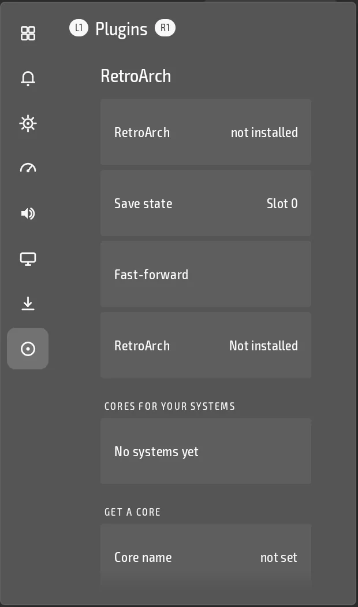

<h1 align="center">RetroArch manager for droidtop</h1>

<p align="center">
  <b>Detect, launch and control the RetroArch you already have.</b><br>
  Core downloads, a Quick Menu panel, and save, load and fast-forward from the companion screen.
</p>

<p align="center">
  <a href="https://github.com/Droidtop/droidtop-plugin-retroarch/releases/latest"></a>
  <a href="https://github.com/Droidtop/droidtop-plugin-retroarch/actions"></a>
  
  <a href="LICENSE"></a>
</p>

<p align="center">
  
</p>

<p align="center">
  <a href="#what-it-does">What it does</a> ·
  <a href="#install">Install</a> ·
  <a href="#root-is-optional">Root</a> ·
  <a href="#for-developers">For developers</a> ·
  <a href="#licence">Licence</a>
</p>

A plugin for [droidtop](https://github.com/Droidtop/droidtop) that works with an **already installed** RetroArch. It never bundles, patches or redistributes any RetroArch code. It talks to your copy the way any other app on the device could.

## What it does

- **Finds RetroArch** on the device and shows whether it is installed, in a status tile.
- **Launches it** with a chosen core and game, through RetroArch's own documented Intent extras.
- **Downloads cores** from `buildbot.libretro.com`, and lists the cores for every system you play with RetroArch.
- **Controls the running game**, when you turn on RetroArch's network commands: save and load state, change slot, fast-forward and shaders, from droidtop's companion screen.
- **Quick Menu panel.** RetroArch's status, your cores and the install action, on R2.

Every fact the plugin relies on is cited against RetroArch's own source in [DESIGN.md](DESIGN.md).

## Install

You need [droidtop](https://github.com/Droidtop/droidtop). You also need RetroArch installed.

1. In droidtop open **Settings > Plugins > Add**. droidtop's own catalog is always there.
2. Pick **RetroArch manager** and press **Install**.
3. Read the permissions it asks for and press **Accept**. Nothing runs until you do.

You can also browse the catalog at [droidtop.github.io](https://droidtop.github.io/), or open this plugin's install page directly: [Install in droidtop](https://droidtop.github.io/install-plugin?catalog=https%3A%2F%2Fraw.githubusercontent.com%2Fdroidtop%2Fdroidtop-platforms%2Fmain%2Fdroidtop-plugins%2Findex.json&id=droidtop.retroarch). That link only opens a review inside droidtop.

## Root is optional

Nothing here needs root. Without it, you download a core and place it through RetroArch's own screens. With a root helper plugin you allow, such as Shizuku running as root, the plugin can also put a downloaded core into RetroArch's own cores folder. The plugin never runs `su` itself. DESIGN.md section 7 lists each feature's non-root and root path.

## For developers

### Layout

- `manifest.template.json` — the plugin manifest (`droidtop.retroarch`,
  `native_bundle`, contract 2: a Quick Menu panel `ui.panel`, a status tile,
  a settings page and the app bridge; an optional `priv.shell` root helper for
  installing cores — see DESIGN.md 7).
- `src/dev/droidtop/plugins/retroarch/RetroArchPlugin.kt` — the plugin.
  `RetroArchViews.kt` holds the pages droidtop draws, `RetroArchState.kt` its
  small files and the core-name rules.
- `build.sh` — compiles+dexes the payload against droidtop's
  `:plugin-host` API (unsigned; this is what CI runs).
- `sign.sh` — signs the built payload into a
  `droidtop.retroarch.droidplugin.tar.xz` installable bundle. Needs the
  droidtop plugin origin's private key; never run in CI.

### Building

```
export PLUGIN_HOST_CLASSPATH=/path/to/plugin-host-debug-classes.jar
export ANDROID_JAR=$ANDROID_SDK_ROOT/platforms/android-36/android.jar
./build.sh
```

`PLUGIN_HOST_CLASSPATH` needs a compiled `dev.droidtop.pluginhost.*`
classpath from a droidtop checkout (`./gradlew :plugin-host:assembleDebug`,
then unzip `classes.jar` out of the resulting AAR) — see
`.github/workflows/build.yml` for exactly how CI does this against
`Droidtop/droidtop`'s own `main`.

## Licence

GPL-3.0, see [LICENSE](LICENSE). It contains no RetroArch source; RetroArch (GPL-3.0) is only downloaded at runtime.
